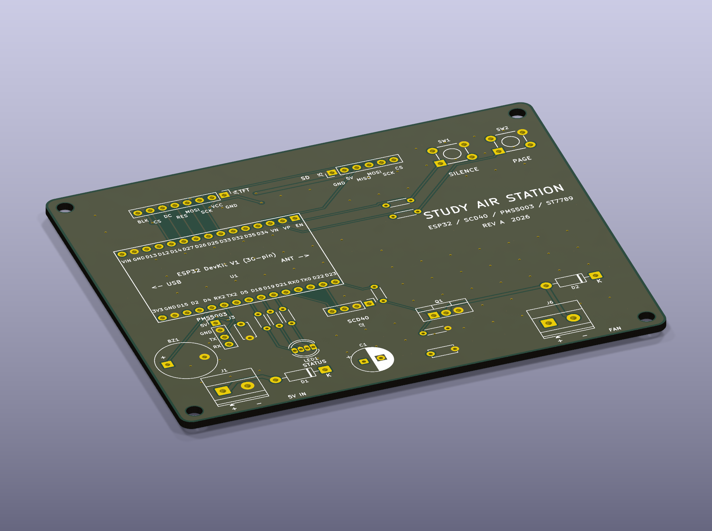
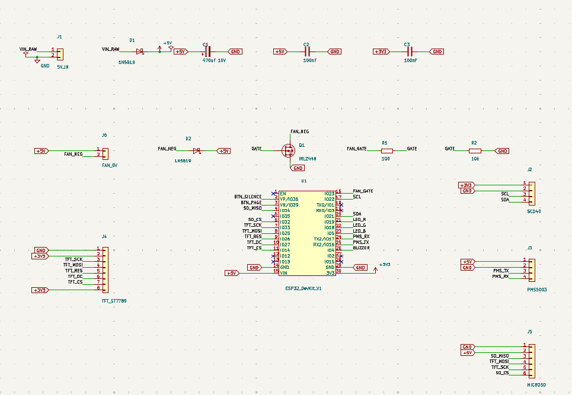
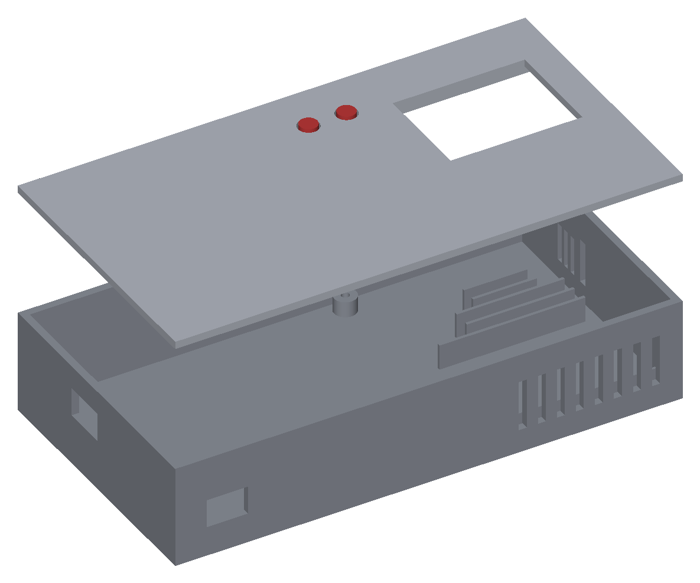

# Study Air Station

A desk air quality monitor. It measures CO2, fine dust, temperature and humidity, shows a live score on a color display, runs a fan when the air gets bad, and sends a Telegram message when it is time to open a window. Everything is logged to a microSD card.

## Why I made it

When I study in a closed room, CO2 climbs past 1500 ppm within an hour and I get tired without knowing why. I wanted a device that shows the number, reacts on its own and keeps a record, so I can see how a room behaves over a day.

## How it works

An ESP32 reads two sensors:

- SCD40 over I2C for CO2, temperature and humidity
- PMS5003 over UART for PM1.0, PM2.5 and PM10

From these it computes a 0 to 100 score and a state (fine, stuffy, alert). The score drives an RGB LED and a bar on the 2.0 inch ST7789 display. The display has three pages, switched with the page button: live values, a 24 hour CO2 graph, and system info.

Layout preview of the three alert states, drawn by the firmware's display code with sample values.

- **Fan.** A 5 V fan is switched by an IRLZ44N. It turns on at 1000 ppm CO2 or 25 ug/m3 PM2.5 and off again 200 ppm and 10 ug/m3 lower, with a 60 second minimum run or rest time so it does not chatter. A long press on the page button forces it on, off or back to auto.
- **Alerts.** At 1500 ppm or 55 ug/m3 the LED blinks red, the buzzer beeps every 30 seconds and a Telegram message is sent immediately. The silence button mutes the buzzer for 10 minutes, then it re-arms by itself. A second message goes out when the air is back to normal.
- **Logging.** One CSV line per minute with a timestamp goes to the microSD card, one file per day. Time comes from NTP, so there is no RTC.
- **Dashboard.** A password protected web page on the local network shows live values, the 24 hour graph, fan and silence controls, the thresholds (editable, kept in flash) and a download link for today's log.

## Hardware

Two layer board, 100 x 80 mm. The ESP32 DevKit plugs into sockets. The SCD40, display, microSD module and PMS5003 connect with short jumper cables to pin headers, so each can sit where it works best in the case. The fan and the 5 V supply use screw terminals. The board takes 5 V on a screw terminal, through a Schottky diode against reverse polarity. Use the ESP32 USB port for programming with the 5 V terminal unplugged.

| Function | ESP32 pin |
| --- | --- |
| SCD40 SDA / SCL | IO21 / IO22 |
| PMS5003 TX to ESP32 / ESP32 to PMS5003 RX | IO16 / IO17 |
| TFT SCK, MOSI | IO33, IO25 (shared with the SD card) |
| TFT CS, DC, RES | IO14, IO27, IO26 |
| SD MISO, CS | IO34, IO32 |
| Fan gate | IO23 |
| Buzzer | IO4 |
| RGB LED R, G, B | IO19, IO18, IO5 |
| Silence button, page button | IO36, IO39 (10k pull-ups on the board) |

## Case

`cad/air_station_case.step` holds a base, a lid and two button caps. The PCB sits on four standoffs on the left. The bay on the right holds the PMS5003 on the floor, the microSD module and the SCD40 standing on their edges in rib slots, and a 25 mm fan on the back wall. The base has a USB opening, a cable opening for the 5 V input, intake slots, an SD card slot in the east wall and air slots for the SCD40. The lid has the display window above the bay and two button holes with printed caps. It takes about 120 g of filament.

## Firmware

`firmware/air_station/air_station.ino`, built with the Arduino IDE.

1. Install the ESP32 board package (board: ESP32 Dev Module).
2. Install the libraries Adafruit GFX Library and Adafruit ST7789 Library.
3. Edit the settings block at the top: WiFi name and password, dashboard password, Telegram bot token and chat id (optional), time zone.
4. Flash. The dashboard stays off until the default dashboard password is changed.

Buttons: silence short press mutes or unmutes. Page short press changes the page, long press cycles the fan mode.

Telegram alerts use HTTPS without certificate checking, so keep the bot token to a bot used only for this. The dashboard uses plain HTTP and basic authentication, so use it on a trusted network only.

## Files

- `hardware/` KiCad project (schematic, PCB, project libraries)
- `firmware/air_station/` Arduino sketch
- `cad/` case, STEP
- `BOM.csv` parts, prices, links
- `images/` renders
